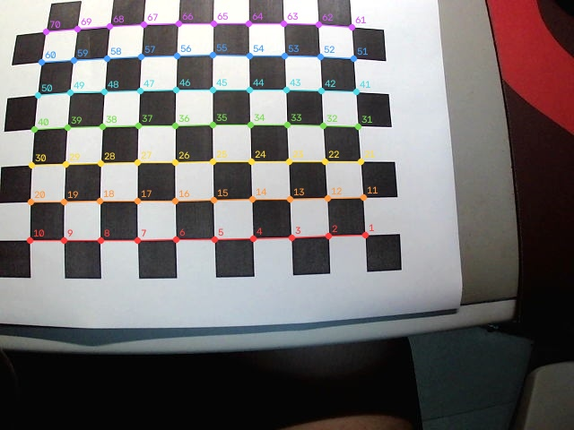
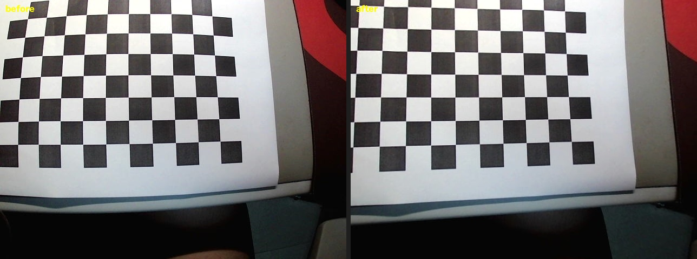

# 培训4 示例：相机内参标定 + 畸变矫正

一个能直接编译、直接跑出结果的最小实现，代码带注释。**建议先把它跑通，再动手写自己的版本。**

对应视频：【参数标定一】内参标定 <https://www.bilibili.com/video/BV1cNBXB5Euv/>

---

## 它做了什么

1. 把 `cam_mix_img.zip` 解压出来的 113 张棋盘格图全部读进来；
2. 每张图用 `cv::findChessboardCorners` 找 **10×7 = 70 个内角点**，再用 `cornerSubPix` 做亚像素精化；
3. 把所有成功检出的图喂给 `cv::calibrateCamera`，算出内参矩阵 `K` 和畸变系数 `D`；
4. 逐张算重投影误差，把误差最大的几张报出来（想再标一次可以剔除它们）；
5. 用 `cv::undistort` 把其中一张图矫正过来，并生成前后对比图。

## 效果

内角点检出结果（按行上色，编号 1~70）：



畸变矫正前后对比：



> 右边看起来"被放大"是正常的：这套图桶形畸变很强，矫正本质上是从原图更靠中间的位置取样，
> 所以中心和边缘的相对比例会变、四角会被裁掉一点。想保留完整视野可以用
> `cv::getOptimalNewCameraMatrix`，代码里注释了怎么改。

## 怎么跑

```bash
# 0) 先把 cam_mix_img.zip 解压到一个目录，比如：
#      Windows:      D:\cam_mix_img\
#      Ubuntu:       ~/cam_mix_img/
#
#    这个目录不要放进仓库（113 张共 7.7 MB）

# 1) 编译
cd 示例/培训4相机标定/calib_demo
cmake -S . -B build
cmake --build build -j

# 2) 跑
./build/calib_demo D:/cam_mix_img            # 只写结果文件
./build/calib_demo D:/cam_mix_img --show     # 顺便弹窗看
```

结果文件写在**当前工作目录**：

| 文件 | 内容 |
|---|---|
| `corners.jpg` | 第一张成功检出的图，70 个角点已编号 |
| `undistort_before.jpg` | 矫正前 |
| `undistort_after.jpg` | 矫正后 |
| `undistort_compare.jpg` | 上面两张左右拼在一起 |

## 参考输出

用全量 113 张跑出来（你那边会有差别，正常）：

```
发现图片: 113 张
角点检出: 96 / 113 张（17 张检不出来，正常）

========== 标定结果 ==========
重投影误差 RMS = 1.4278 像素
内参矩阵 K =
[629.4776, 0, 311.8737;
 0, 633.4524, 218.3417;
 0, 0, 1]
畸变系数 D = [-0.42297, 0.20363, 0.00016, 0.00071, -0.02898]
  （顺序 k1, k2, p1, p2, k3）
fx=629.4776  fy=633.4524  cx=311.8737  cy=218.3417
```

**怎么判断结果对不对**：

- `RMS` 在 **1~2 像素**之间是好的；大于 3 说明有坏图，剔除几张再试试；
- `fx / fy` 在 **500~800** 之间（640×480 的普通相机都在这附近）；上一千或只有几十，几乎肯定是标定板尺寸写错（99% 是写成 11×8 了）；
- `cx / cy` 应该接近图像中心 `(320, 240)`，差个十几二十像素是正常的；
- `k1` 一般是负的（桶形畸变）。

## 参数说明

```cpp
static const int    kCols     = 10;    // 内角点列数 ← 不是方格数 11
static const int    kRows     = 7;     // 内角点行数 ← 不是方格数 8
static const double kSquareMm = 15.0;  // 每格 15 mm
```

`findChessboardCorners` 要的是**内角点**数量，也就是黑白格交界处的那些点。
标定板是 11 列 × 8 行方格，所以内角点是 **10 × 7**。写成 `Size(11, 8)` 会一个点都检不出来。

`kSquareMm` 只影响平移向量 `tvecs` 的物理尺度，**不影响内参 `K`**。板子是 15 mm 就填 15。

## 两个环境相关的坑

1. **`projectPoints` 的头文件位置**变了：OpenCV 4.x 在 `opencv2/calib3d.hpp`，OpenCV 5 挪到了
   `opencv2/geometry/3d.hpp`。示例里用 `__has_include` 两行都兜住了，你在 Ubuntu 22.04（OpenCV 4.5.4）
   上只写 `#include <opencv2/opencv.hpp>` 一般是够的，编不过就加上 `calib3d.hpp`。

2. **中文路径**：`cv::imread` / `cv::imwrite` 碰到中文路径在 Windows 上可能静默失败
   （返回空 Mat、文件不生成）。示例里的输出文件名全用英文就是为了避开这个坑。